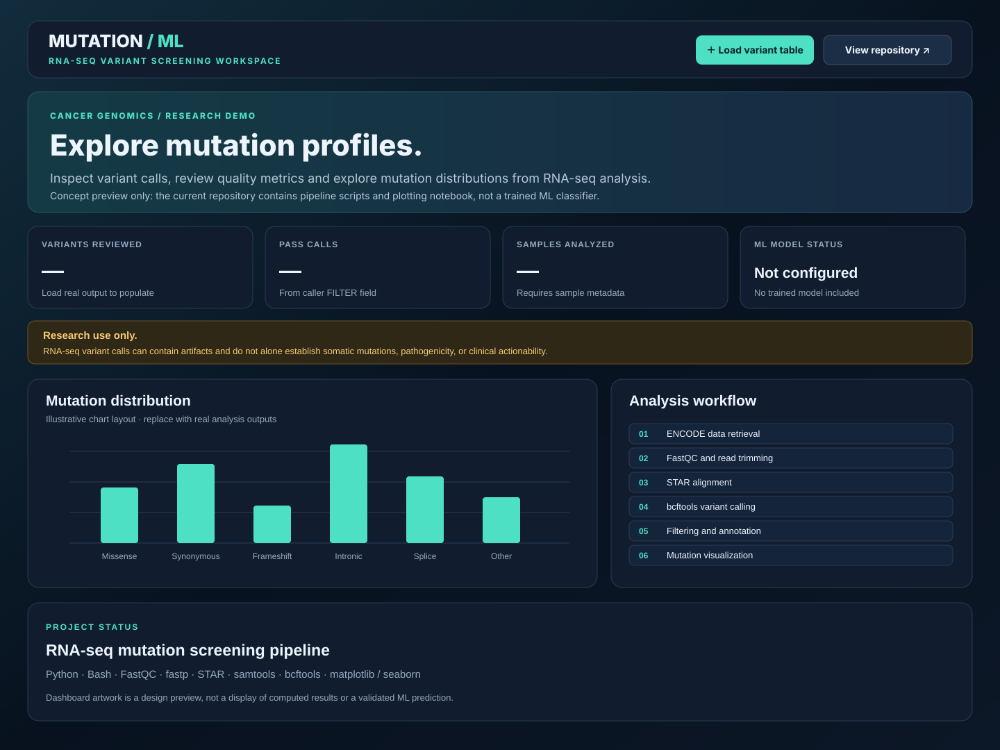

# Mutation Screening Workbench

Research-oriented RNA-seq variant-calling prototype with a browser-based VCF explorer and a reproducible ClinVar dataset-preparation workflow. Built with Python, Bash, FastQC, fastp, STAR, samtools, bcftools, pandas, and scikit-learn.



> **Status:** Research prototype. The repository does not yet contain a clinically validated mutation classifier. The ClinVar preparation script builds a labelled research table; it does not claim to train a valid clinical model. The preview is conceptual.

[**Open the browser VCF workbench**](https://gitsiba.github.io/mutation_screening_ml/) · [Source code](https://github.com/Gitsiba/mutation_screening_ml)

## Current capabilities

- Configurable ENCODE FASTQ download using a real file accession supplied by the user.
- Single-end read QC, trimming, STAR alignment, and BAM indexing script.
- bcftools mpileup/call wrapper with checked subprocess pipeline.
- Browser-based VCF explorer with local parsing, search, FILTER filtering, chromosome counts, and CSV export.
- **ClinVar dataset preparation:** downloads the official NCBI variant summary, filters unambiguous reviewed GRCh38 SNVs, maps labels to benign/pathogenic, deduplicates allele IDs, and writes a provenance manifest with source hash and filter counts.
- General supervised ML training scaffold; no trained model or clinical validity is claimed.

## ClinVar labelled dataset: quick start

This is a **binary germline variant-classification benchmark**, not cancer detection. It maps `Pathogenic`/`Likely pathogenic` to `pathogenic` and `Benign`/`Likely benign` to `benign`; excludes uncertain/conflicting labels and requires selected higher-transparency review statuses. It restricts to GRCh38 simple single-nucleotide variants and one row per non-conflicting ClinVar `AlleleID`.

```bash
python -m pip install pandas
python data_download/prepare_clinvar_dataset.py
```

Outputs are generated locally:

- `data/raw/clinvar/variant_summary.txt.gz`
- `data/processed/clinvar_binary_snv.csv`
- `data/processed/clinvar_binary_snv.manifest.json`

The script records retrieval timestamp, URL, SHA-256, filters, and row/label counts. ClinVar changes over time, so preserve the source file and manifest to reproduce a run. See [dataset documentation](data_download/README_clinvar.md) for source verification, access policy, label definitions, feature-selection guidance, and limitations.

**Leakage warning:** only use `reference_allele`, `alternate_allele`, `variant_type`, `ref_gc`, `alt_gc`, and `transition` as baseline features. `clinical_significance_source`, `review_status_source`, identifiers, chromosome and position are provenance columns and must not enter the model. The simple baseline features are intentionally limited and may perform poorly; stronger work needs independently sourced biological features and gene/locus-held-out evaluation. Do not use this for diagnosis or patient-care decisions.

## RNA-seq variant workflow

```text
ENCODE FASTQ accession
        |
        v
FastQC -> fastp -> STAR -> sorted BAM -> samtools index
                                          |
Reference FASTA + index ------------------+
                                          v
                               bcftools mpileup -> bcftools call
                                          |
                                          v
                                      variants.vcf
                                          |
                                          v
                              Browser VCF exploration
```

### Download and align a real ENCODE file

Choose a suitable FASTQ file from the [ENCODE portal](https://www.encodeproject.org/), confirming organism, assay, biosample, read layout, and accession.

```bash
export ENCODE_FILE_ID=ENCFF_REPLACE_WITH_REAL_ACCESSION
python data_download/download_encode_data.py
FASTQ=data_download/REAL_FILE_ID.fastq.gz STAR_INDEX=reference/star_index THREADS=4 bash preprocessing/fastqc_trim_align.sh
```

The shell workflow is configured for single-end reads. Prepare a matching STAR index and reference FASTA first. To call candidate variants:

```bash
REFERENCE_FASTA=reference/genome.fa BAM=preprocessing/aligned.bam \
  VCF_OUTPUT=mutation_screening/variants.vcf python mutation_screening/variant_calling_pipeline.py
```

The reference genome, annotation and build must match the sample and analysis plan. RNA-seq variant calls are candidate calls and may be affected by mapping artifacts, RNA editing, splice junctions, coverage, and expression. A VCF alone does not establish somatic status.

## Browser VCF explorer

Open the [Mutation Screening Workbench](https://gitsiba.github.io/mutation_screening_ml/), choose a plain-text `.vcf`, search/filter records, inspect chromosome counts, and export visible rows. The demo parses the selected file in the browser; it does not upload the file. Compressed `.vcf.gz` is not supported directly.

## General ML scaffold

For other curated labelled tabular datasets, install dependencies and follow [ML input guidance](ml/README.md):

```bash
python -m pip install -r requirements-ml.txt
python ml/train_model.py --input path/to/labelled_features.csv --target validated_label --output-dir ml/results
```

Do not use random row-level splits when related variants, genes, samples or patients can cross the split. Choose a split matching the intended generalization question.

## Attribution, access and responsible use

ClinVar data are publicly accessible. NCBI asks users to attribute ClinVar when copying or redistributing its data; cite Landrum et al., *Nucleic Acids Research* (2025), doi:10.1093/nar/gkae1090. Read the [ClinVar data-use policy](https://www.ncbi.nlm.nih.gov/clinvar/docs/maintenance_use/) and [review-status definitions](https://www.ncbi.nlm.nih.gov/clinvar/docs/review_status/). ClinVar submissions are not independently verified by NCBI in every case. The dataset and all code are for research/education, not diagnosis, treatment or clinical decision-making.

## Limitations and next steps

This project is not a production pipeline: environment pinning, full sample metadata validation, paired-end orchestration, comprehensive annotation, end-to-end fixtures, and independent model validation remain future work. No performance numbers should be reported until a specific dataset release is processed and a leakage-resistant evaluation has actually run. No repository license is currently specified; add one before inviting code reuse or contributions.
